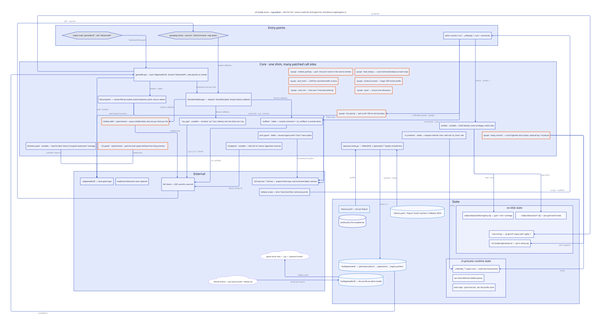

# sof_buddy-server — for humans

> A server-side `gamex86.dll` shim for Soldier of Fortune 1 that loads the stock game DLL beside it and adds features by detouring engine and game code, driven by YAML and JSON rather than by editing a binary.

Read it left to right:

- **Entry points** — install is one file swap: rename the stock `gamex86.dll` to `oldgamex86.dll` and drop this shim in its place. The engine calls the shim's single export, `GetGameAPI`, and admins touch everything else through `_sofbuddy_*` cvars and a handful of console commands.
- **Core** — the shim loads the stock DLL, forwards `GetGameAPI`, then patches call sites listed in `detours.yaml` and per-feature `hooks`/`callbacks` JSON. `generate_hooks.py` turns those files into `generated_*` code at build time, so adding a hook never means hand-editing the generator. One module per line, tier included.
- **Tiers are the release story** — `master`, `unstable` and `experimental` are the same source tree; the branch picks a profile and the profile compiles the stable / +unstable / +experimental feature set. That is why a cvar can be documented and still not exist on your server.
- **State** — almost nothing is durable. Gauges, deferred reliable queues, hash maps and zpool free lists die with the process, and `spsv` reloads the DLL between game restarts, so `DllMain` strips every patch. Only the profiles registry, per-guid stats, the opt-in clamp log and `User/sof.log` outlive a game.
- **External** — nothing replaces the engine or the game: it detours `oldgamex86.dll` and `SoF-spsv.exe` in place. The experimental bundle is deliberately hot-coloured because `cpu_optimizations` and `reliable_defer` rewrite the tick loop, allocator and reliable netchan — the usual source of movement glitches.

Source: [`docs/system.d2`](docs/system.d2). Edit that, then run [`scripts/render-diagram.sh`](scripts/render-diagram.sh).
