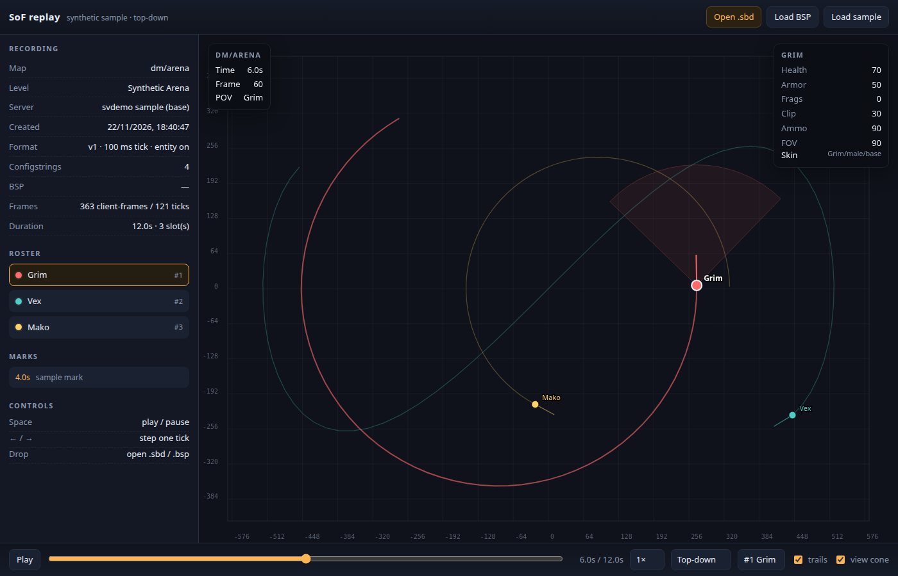
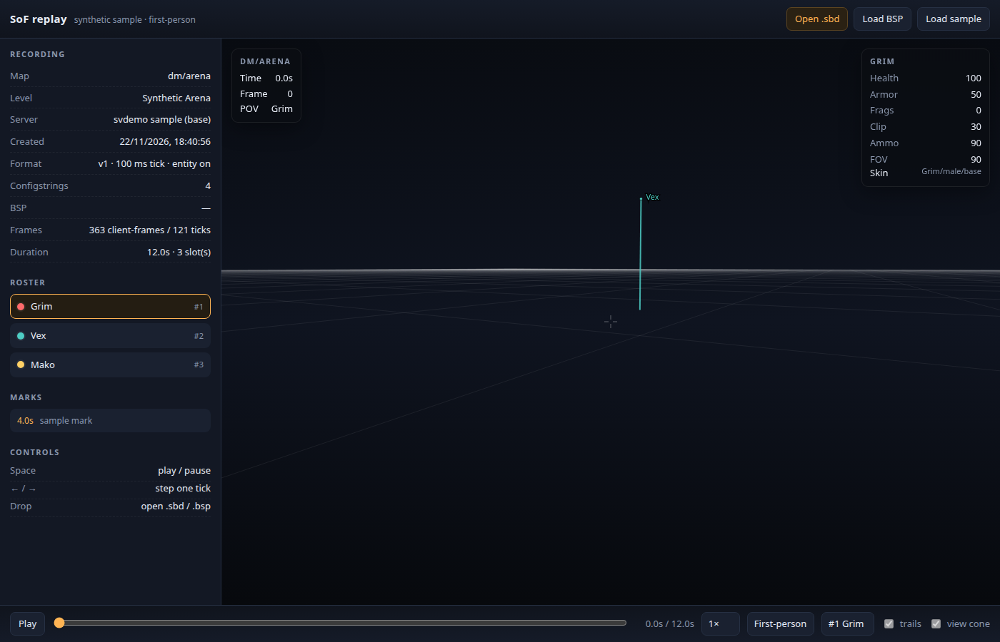
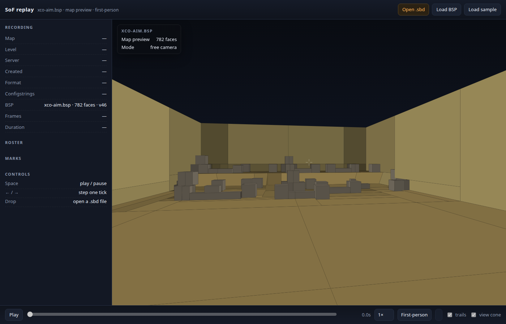
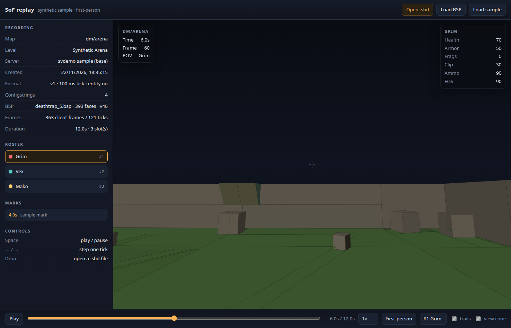

# `.sbd` state demo viewer

A dependency-free browser viewer for the `server_demo` feature. It parses the
versioned `.sbd` container directly in the browser — no server, no build step,
no network protocol.



There are two view modes:

- **Top-down** — positions, view direction, trails, view cone and POV stats.
- **First-person** — a camera at the selected POV using `ps.eye`,
  `ps.viewangles` and `ps.fov`, with a ground grid and the other players
  projected as billboards. *(No BSP geometry yet; this is a camera preview,
  not the final 3D renderer.)*



BSP geometry, world entities and a first-person camera with actual map
geometry are the next layer; the parser and timeline here are reusable for
that.

## Run

Open [`index.html`](index.html) directly, or serve the folder:

```bash
tools/svdemo_viewer/serve.sh
# http://127.0.0.1:8000/
# http://127.0.0.1:8000/?sample=1&t=6000
```

`?sample=1` loads a synthetic 12-second demo so the viewer is testable without
a recording. `t=<ms>` seeks, `play=1` starts playback, and `view=fp` opens the
first-person camera.

```
?sample=1&t=6000
?sample=1&t=0&view=fp
```

## Load a real recording

```bash
# on the game server:
svdemo_start test
# play for a while
svdemo_stop
```

Then drag the resulting `<userdir>/demos/test.sbd` onto the viewer, or use
**Open .sbd**.

## Load a map (BSP v46)

Use **Load BSP** or drop a `.bsp` file. The viewer parses the SoF BSP v46 world
model directly: vertices, edges, faces, planes, texinfo and the world model.
First-person mode then draws the actual map geometry instead of the reference
grid:



This pass is **flat-shaded**:

- face colour comes from a material-name heuristic (`grass`, `sand`, `metal`,
  `wood`, `stone`, …), modulated by the face's average lightmap sample;
- textures, texture coordinates and per-pixel lightmaps are not loaded yet;
- player and world models are still billboards/markers, not MD2/Ghoul meshes;
- the sky is the background gradient; sky faces are skipped.

The parser loads only the world model (model 0), so doors/lifts and other
brush submodels are not drawn yet. It also reads the entity lump for a spawn
point and `info_player_intermission`, so a BSP can be previewed without a
recording. `?cam=x,y,z,yaw,pitch` overrides the preview camera.

URL shortcuts:

```
?sample=1&view=fp&bsp=deathtrap_5.bsp
?view=fp&bsp=xco-aim.bsp&cam=0,0,100,0,0
```

With a `.sbd` recording loaded, the same map is drawn from the selected POV
and the other players are projected as billboards:



The BSP file itself is a game asset and is not in this repository.

## What it shows

- **Timeline:** every recorded server tick (usually 10 Hz), with interpolation
  between ticks for smooth movement. Space toggles play; arrow keys step ticks;
  speed is 0.25×–4×.
- **Top-down map:** X/Y world coordinates auto-fitted to all recorded player
  and body positions. The grid step adapts to zoom.
- **First-person camera:** the selected POV's eye position and Quake view
  angles, with `ps.fov`; ground grid and other players projected into view.
- **Trails:** the last 60 seconds per slot, with the selected POV highlighted
  (top-down only).
- **Players:** position, view direction, focus ring for the selected POV, body
  origin hint, spectator dashed ring, and name from the roster.
- **POV:** choose a slot; the top-down cone uses `ps.fov` and
  `ps.viewangles[1]`.
- **Stats:** health, armor, frags, clip, ammo from `player_state_t.stats`.
- **Skin/model:** resolved from `CS_PLAYERSKINS`/`CS_MODELS` configstrings,
  with the roster userinfo as a fallback for late joiners.
- **Marks:** `svdemo_mark` events; click to seek.

## Parser

[`svdemo.js`](svdemo.js) is the browser/Node parser. It mirrors
[`server_demo_format.h`](../../src/features/server_demo/server_demo_format.h)
and exposes:

```js
const demo = Svdemo.parse(arrayBuffer);
demo.header;        // map/level/server/format
demo.frames;        // raw client-frame chunks
demo.groups;        // frames grouped by timeMs, slots map
demo.slots;         // sorted slots seen in roster/frames
demo.slotTrails;    // per-slot [{timeMs, x, y, z, yaw}]
demo.bounds;        // auto-fit world bounds
demo.events;
demo.end;
Svdemo.findGroupIndex(demo.groups, timeMs);
```

## Limitations

- BSP is flat-shaded: no textures, texture coordinates or per-pixel lightmaps
  yet. Face colour comes from a material-name heuristic plus an average
  lightmap sample.
- Only BSP model 0 (the world) is drawn; doors/lifts and other brush submodels
  are not.
- Faces are sorted with a painter's algorithm (average camera depth), not a
  z-buffer; intersecting faces can occasionally order incorrectly.
- Players are billboards, not MD2/Ghoul meshes, and billboards are drawn after
  the map (not occluded by walls).
- Roster changes are collapsed to the latest name per slot; the wire format
  carries all roster updates, so a future version can show name changes over
  time.
- Configstrings are captured and used for player skin/model paths, but world
  entity model indexes are not resolved/rendered yet.
- No chat/join/leave events yet; the format reserves `EVENT` kinds for them.

## Tests

```bash
tools/tests/svdemo_viewer/run.sh
```

The test compiles the real C++ writer (`make_fixture.cpp`), writes a fixture,
and feeds those bytes to `svdemo.js` under Node. It also checks truncation,
bad magic, and the synthetic sample path. `bsp.test.mjs` builds a minimal BSP
v46 file in memory and checks the world face, winding, normal, texinfo and
spawn parsing; no game asset is required.
